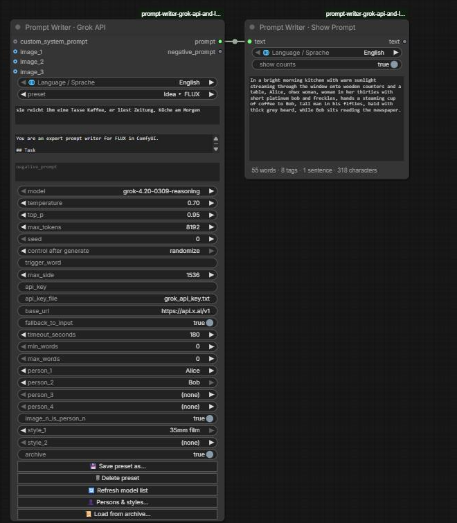
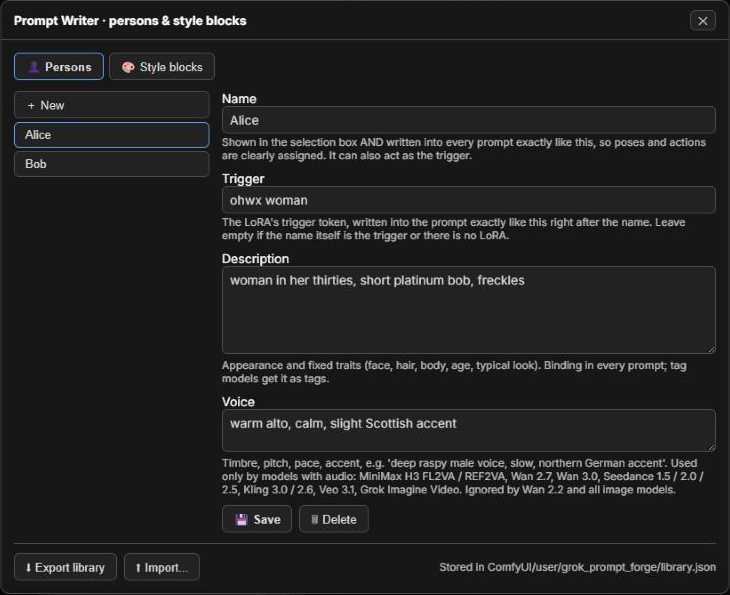
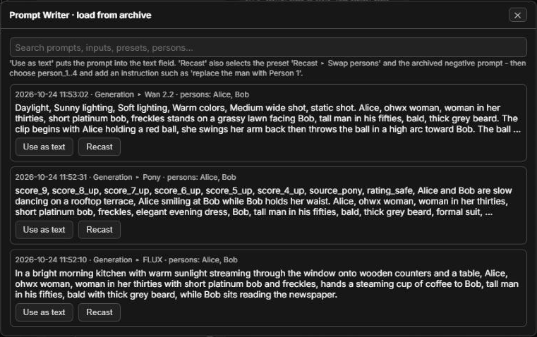
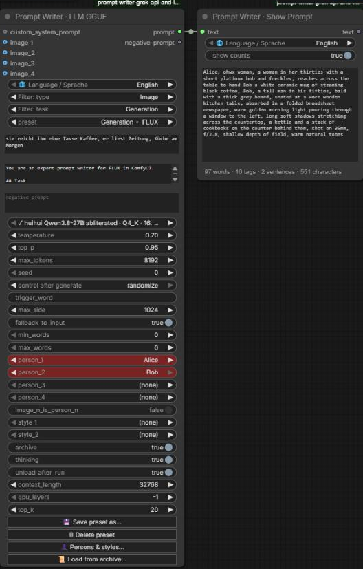
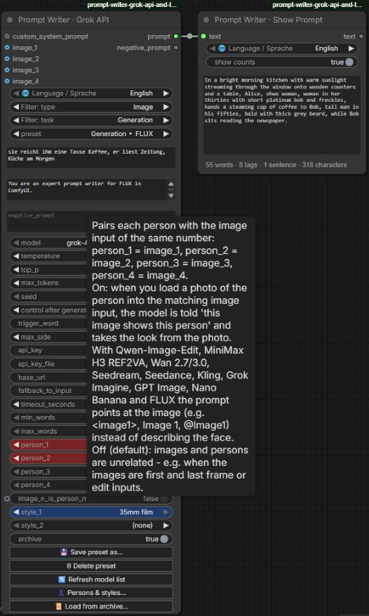

# prompt-writer-grok-api-and-llm-gguf

**Prompt Writer – Grok API & LLM GGUF** is a ComfyUI custom node pack that writes prompts for you. Give it a short idea or an existing caption in any language, and it writes an English prompt tuned for the image or video model you want to use. It can also rewrite captions for LoRA training and describe images.

You can choose between two ways to let it write:

| Node | Writes with | Good to know |
|---|---|---|
| **Prompt Writer · Grok API** | the **xAI Grok API** (cloud) | best quality, needs an xAI API key, costs a fraction of a cent per prompt |
| **Prompt Writer · LLM GGUF** | an uncensored **Qwen3.8-27B** on your own NVIDIA GPU | no API key, no costs, offline after a one-time download |

Both nodes share everything else:

- **Presets per target model:** each target model has its own task preset with a matching system prompt, standard negative prompt and sampling settings.
- **Your own persons and style blocks:** pick them from a local library and they appear in every prompt, with every action clearly assigned by name.
- **Prompt archive:** every result can be found and reused later.
- **Prompt Writer · Show Prompt** displays the result with a word count.
- **English or German:** the nodes can be shown in either language. Hover over any option for a beginner-friendly explanation.

## Screenshots



*Prompt Writer · Grok API turns a German idea into a FLUX prompt featuring two persons from the library. Show Prompt displays the result with its counts.*

| Persons & style blocks | Prompt archive |
|---|---|
|  |  |



*Prompt Writer · LLM GGUF writes the same kind of prompt with a local Qwen3.8-27B. The ✓ marks a model that is already downloaded.*



*Every option has a tooltip. The language switch at the top of each node also shows everything in German.*

## Typical pipelines

```
Idea -> prompt:
[your idea, any language] -> [Prompt Writer · Grok API or LLM GGUF: "Idea ▸ FLUX"]
        -> prompt ----------> [Prompt Writer · Show Prompt] -> [CLIP Text Encode +]
        -> negative_prompt -----------------------------------> [CLIP Text Encode -]

Caption rewriting (batch):
[Prompt Writer · Text File Loader] -> [Prompt Writer: "Caption ▸ LoRA training caption"] -> [Save Text File]

Edit instruction with reference images:
[Load Image] x2 -> image_1, image_2 -> [Prompt Writer: "Idea ▸ Qwen-Image-Edit 2.1"] -> [Qwen edit workflow]
```

## Nodes

All nodes are in the node menu under **Prompt Writer**.

| Node | Purpose |
|---|---|
| **Prompt Writer · Grok API** | Prompt writing, caption rewriting and image captioning through the xAI Grok API. It has three optional image inputs, a custom system prompt input and 30 built-in task presets. You can save your own presets, pick up to four persons and two style blocks from your library, and reload results from the archive. Outputs `prompt` and `negative_prompt`. |
| **Prompt Writer · LLM GGUF** | The same with a local, uncensored **Qwen3.8-27B** (huihui abliterated or HauhauCS Aggressive, several sizes) instead of the API. The chosen model and its vision projector are downloaded on the first run. Needs llama-cpp-python with CUDA: see **[docs/LOCAL_GGUF.md](docs/LOCAL_GGUF.md)** for the installation and which model fits your GPU. |
| **Prompt Writer · Show Prompt** | Shows a text on the node and passes it on unchanged. Below the text, a status line counts words, tags (comma-separated parts), sentences and characters; switch it off with "show counts". Counting is done locally, needs no API call, and never re-runs anything. The last text is kept with the workflow. |
| **Prompt Writer · System Prompt Loader** | Loads a system prompt from a `.txt` file and reloads it automatically when the file changes. Connect it to `custom_system_prompt`. |
| **Prompt Writer · Text File Loader** | Loads `.txt` files from any folder one after another, in natural sort order, for batch runs. Outputs the text, the filename without extension, the full path and the file count. |

## Shared by both writer nodes

### Language

The switch **🌐 Language / Sprache** at the top of the writer nodes and Show Prompt shows them in **English** or **Deutsch**: field labels, tooltips, inputs and outputs, buttons, dialogs, notifications and preset notes.

- It only changes what you see. It is not saved in the workflow and it doesn't re-run a node. Your choice is remembered in the browser and applies to all nodes of this pack.
- Preset names stay English because they are saved in workflows.
- The system prompts sent to the model and the generated prompt stay English.
- The short node description shown when you hover over a node's title stays English, because ComfyUI keeps it read-only.

### Presets

Choosing a preset fills `system_prompt`, `negative_prompt`, `temperature`, `top_p` and `max_tokens` with values tuned for that task, and a short note about the preset pops up. You can change any of these values on the node.

- **💾 Save preset as...** stores the current values under a name you choose.
  - The presets are saved in `ComfyUI/user/grok_prompt_forge/presets.json`, so they survive updates of the pack.
  - Saving under the name of a built-in preset replaces its values on your install.
- **🗑 Delete preset** removes one of your presets. On an overridden built-in preset it restores the built-in values.

The preset only labels the values. The node always runs with the values shown in its fields, so a workflow shared with someone who doesn't have your presets still runs unchanged.

| Preset | What it does |
|---|---|
| Custom system prompt | Your own system prompt. Left empty, only the node's own rules are sent (see below). |
| Caption ▸ LoRA training caption | Refines a raw caption (e.g. from JoyCaption) into a training caption. If you put your LoRA's trigger token into `trigger_word`, the subject's fixed traits are removed so they bind to that token. |
| Caption ▸ Describe image | Captions `image_1`. Optional text adds extra instructions or a question about the image. |
| Recast ▸ Swap persons | Swaps the persons in an existing prompt for the selected `person_1..4`; everything else stays (see below). |
| Idea ▸ *target* | Expands a short idea into a full prompt for the target model. |
| Caption ▸ *target* | Rewrites an existing caption faithfully (nothing new is added) into the target model's prompt style. |

**Targets:** Krea 2 · Qwen-Image 2.1 · Qwen-Image-Edit 2.1 · Z-Image · FLUX · Illustrious · Pony · SDXL · Wan 2.2 · Wan 2.7 · Wan 3.0 · MiniMax H3 FL2VA · MiniMax H3 REF2VA

| Target | Prompt style | Standard negative prompt |
|---|---|---|
| Krea 2 | One natural-language paragraph, 60–200 words; text to render goes in quotes | Generic. Only used by Raw at CFG > 1; Turbo runs at CFG 0. |
| Qwen-Image 2.1 | Observer-style paragraph of about 400–500 words that walks through the frame and ends with "The overall composition …" | Official Qwen negative (Chinese). Ignored at CFG 1. |
| Qwen-Image-Edit 2.1 | Edit instruction that refers to the inputs as `<image1>`…`<image3>`, plus one preservation clause | none (CFG 1) |
| Z-Image | Long natural-language description; constraints phrased positively | Generic. Only used by Base; Turbo has no CFG. |
| FLUX (FLUX.2 / FLUX.1) | Subject → action → style → context, 30–80 words | none (FLUX does not support negatives) |
| Illustrious | Danbooru tags, quality tags first | Official Illustrious negative |
| Pony | `score_9, score_8_up, …` + source and rating tags + short description + tags | Community standard |
| SDXL | Short sentence + comma phrases, 30–75 words | Community standard |
| Wan 2.2 | T2V: cinematic setting terms + subject + detailed motion. I2V (start frame on `image_1`): motion and camera only | Official Wan negative (Chinese) |
| Wan 2.7 / 3.0 | Entity + scene + motion + aesthetics + sound; multi-shot `Shot 1 [0-3s]`; references as "Image 1" | Official Wan negative (Chinese) |
| MiniMax H3 FL2VA | Alignment line + `integrated_multimodal_description` / `overall_soundscape` / `non_diegetic_music`; `image_1` = first frame, `image_2` = last frame | none |
| MiniMax H3 REF2VA | The six full-reference sections with `<Subject N>` / `<Picture N>` labels; `image_1..3` = reference pictures | none |

The guides inside the presets follow each model's official sources:

- Krea 2: `docs/prompting.md` and `docs/expansion.txt`
- Qwen-Image 2.1: the PE-T2I and PE-I2I rewriter prompts
- Z-Image: the official prompt enhancer
- FLUX: BFL's FLUX.2 prompting guide
- Wan 2.2: `system_prompt.py`
- Wan 2.7 / 3.0: the Alibaba Model Studio video guide
- MiniMax H3: its own prompt-writing guides

For Illustrious, Pony and SDXL they follow the model cards plus established community practice. For **Wan 3.0** there is little model-specific guidance yet, so its preset follows the Wan 2.7 guide.

Every target guide also ends with **an example of a good result**. It is marked as a model for form and length only, never for content. Local models in particular follow a concrete example far more reliably than written rules alone.

### Inputs

| Input | Meaning |
|---|---|
| `text` | Your input in any language: an idea, a caption or an edit request. You can type it or connect a string. The output is always English. Only text that should appear in the picture and spoken dialogue stay in their original language. |
| `custom_system_prompt` | When connected and not empty, it **always** replaces the preset's system prompt. |
| `image_1` … `image_3` | Optional single images, not batches; only the first image of a batch is used. The model sees each one as "Image N" by its slot number, so an empty slot doesn't shift the numbering. The tooltip explains how each preset uses them. |
| `trigger_word` | Trigger token for "Caption ▸ LoRA training caption". It replaces `{trigger}` in the system prompt. |
| `negative_prompt` | Passed straight to the `negative_prompt` output. It is not sent to the model. |
| `min_words` / `max_words` | Optional length of the result, 0 = off. The tooltip shows the length recommended for the selected preset's target model. When set, the range is binding and overrides the preset's length guidance. Tag lists count each tag as one word; MiniMax H3 formats apply the range to the main description. |

### Persons, style blocks and the archive

**👤 Persons & styles...** opens your library. It is stored in `ComfyUI/user/grok_prompt_forge/library.json`, so your characters never end up in the node pack or a repository.

| Library entry | Fields | Used by |
|---|---|---|
| Person | **Name:** written into every prompt exactly as given, so every pose and action is clearly assigned; it can also act as the trigger. **Trigger:** the LoRA's trigger token, written right after the name (leave it empty if the name is the trigger). **Description:** appearance and fixed traits, binding. **Voice:** timbre, pitch, pace, accent. | `person_1` … `person_4`. The voice is used only by MiniMax H3 FL2VA / REF2VA, Wan 2.7 and Wan 3.0, the models with audio. |
| Style block | **Text:** e.g. a camera look, a lighting mood or a ban list | `style_1`, `style_2`; applied to every result |

- **Using persons in your text:** refer to a selected person by name or as "Person 1"…"Person 4". Selected persons always appear in the result, even if the text doesn't mention them.
  - Each person is introduced once as "name, trigger, description".
  - After that, every pose, action, gaze and line of dialogue is attributed to a person by name, with no ambiguous "she" or "the woman" when several persons are present.
  - Tag models (Pony, Illustrious, SDXL) get the name first, then the trigger, then the description as tags.
- **`image_n_is_person_n`** (on by default) pairs each person with the image input of the same number: `person_1` = `image_1`, `person_2` = `image_2`, `person_3` = `image_3`. `person_4` has no image input.
  - Load a photo of the person into the matching image input, and the model takes the look from it.
  - With Qwen-Image-Edit (`<imageN>`), MiniMax H3 REF2VA (`<Picture N>`), Wan 2.7 / 3.0 reference-to-video ("Image N") and FLUX.2 multi-reference, the prompt points at the image instead of describing the face.
  - Turn it off when the images mean something else, e.g. the first and last frame of H3 FL2VA.
- **Export / Import** in the dialog moves the library between installs. On import you choose whether names that already exist are replaced or kept.
- **Archive:** with `archive` on, every result is appended to `ComfyUI/user/grok_prompt_forge/archive.jsonl` together with its input, preset, persons and settings. **📜 Load from archive...** searches it:
  - *Use as text* puts an archived prompt into `text`.
  - *Recast* also selects the preset **"Recast ▸ Swap persons"** and the archived negative prompt.

  Then pick the new person(s) and add an instruction such as "replace the man with Person 1". The action, background, lighting, camera, style and format stay as they are; only the person changes, including pronouns and gendered details.

### Rules added to every request

These rules are appended to every system prompt, whether built-in, edited or connected via `custom_system_prompt`. The two below always apply; the persons and the selected style blocks are added as binding sections in the same way.

- **The user's input is binding.** Every explicit wish or instruction in `text` is carried out, for example "no people", "night scene" or "write it as one sentence without score tags". If it conflicts with the preset's guidance, the input wins. Only the output format and the English-output rule stay.
- **Length,** only if `min_words` or `max_words` is set.

The console logs the word and tag count of each result whenever a range is set. Language models count well but not perfectly, so expect an occasional miss of a few words.

### Sampling: temperature and top_p

Every time the model writes a word, it ranks all candidate words by probability and draws one.

- **temperature reshapes the dice.** Low values (0.1–0.4) almost always pick the top-ranked word, so the output is faithful and repeatable. Use them for caption rewriting and edit instructions. High values (0.7–1.0) give unusual words a real chance, so ideas get expanded in varied ways. Above about 1.3, grammar falls apart.
- **top_p removes dice faces.** It keeps only the most likely words up to the probability share `p` and throws away the rest entirely. Keep it high (0.9–1.0) and steer with temperature. At `1.0` it is not sent at all.

The preset values follow what official prompt enhancers use:

- Qwen-Image's rewriter: 1.0 / 0.95
- Z-Image: 0.7 / 0.8
- Hunyuan: 0.7 for T2I, 0.1 for edits
- FLUX.2: 0.15

| Task | temperature | top_p |
|---|---|---|
| Idea ▸ image models | 0.7 – 0.8 | 0.9 – 0.95 |
| Idea ▸ video models | 0.8 (H3: 0.6, strict format) | 0.95 |
| Idea ▸ Qwen-Image-Edit | 0.3 | off |
| Caption ▸ … (faithful rewrite) | 0.2 – 0.4 | off |
| LoRA training caption / describe image | 0.2 / 0.3 | off |

#### What sampling can not fix

Sampling only adds variety at the word level. It cannot stop the model from favouring the same motifs, like golden-hour backdrops or centered poses. If your images still look alike:

- **Add a ban list to the system prompt.** For example: `Never use: golden hour, neon lights, rain-slicked streets, ...`. Save the result as your own preset.
- **Feed randomness in.** Put randomized scene ingredients into `text`, using wildcard nodes or the Text File Loader with `loop_at_end`.

### seed (cache-breaker)

ComfyUI only re-runs a node when one of its inputs changed. The `seed` is there to control that.

- **randomize:** a fresh prompt on every queue run.
- **fixed:** identical input reuses the cached result. With the Grok API this saves money when rewriting captions.

The Grok API node doesn't send the seed to the API at all. The LLM GGUF node passes it to the model, so *fixed* also gives the same output for the same input.

## Prompt Writer · Grok API

### Model

The default model is **`grok-4.20-0309-reasoning`**. It's very affordable and has the least censorship of all Grok models. Tested against the API on 2026-10-24:

- It accepts `temperature` and `top_p`.
- It **rejects** `presence_penalty`, `frequency_penalty` and `reasoning_effort`, so the node has no penalty settings.
- It thinks before answering, and the hidden reasoning counts against `max_tokens`. An edit instruction took about 3 500 reasoning tokens. The presets therefore use 8192–12288; you only pay for the tokens actually used.
- If `max_tokens` runs out before any answer is written, the node reports it clearly instead of returning an empty string.

The model dropdown lists every model your key can use with this node. It is loaded from the API at start-up and on **🔄 Refresh model list**, and cached in `ComfyUI/user/grok_prompt_forge/models.json`.

Multi-agent models such as `grok-4.20-multi-agent-0309` are left out. The API rejects them on chat completions ("Multi Agent requests are not allowed on chat completions"), which this node uses. They are research models that run several agents in parallel to search and cross-check facts, so they bring nothing for prompt writing.

### API key setup

Get a key at **https://console.x.ai**. The key is looked up in this order:

1. `api_key` widget. **Not recommended**, because the key would be saved inside exported workflows.
2. Environment variable `XAI_API_KEY`.
3. **Key file (recommended):** `grok_api_key.txt`, containing only the key. It is searched for in:
   - the ComfyUI root (next to `main.py`)
   - the portable root (next to `run_nvidia_gpu.bat`)
   - this pack's folder

   The file must be named exactly **`grok_api_key.txt`**. Windows hides known file extensions by default, so a file you name "grok_api_key.txt" in Explorer can silently end up as `grok_api_key.txt.txt`, and the node won't find it. To check, turn on *View → Show → File name extensions* in Explorer.

Never share workflows or screenshots containing your key.

## Prompt Writer · LLM GGUF

The node works like the Grok API node; only the model fields differ.

| Field | Meaning |
|---|---|
| `model` | huihui Qwen3.8-27B abliterated (IQ2_S 8.4 GB … Q5_K 19.5 GB) or HauhauCS Qwen3.8-27B Aggressive (IQ2_M 10.3 GB … Q5_K_P 20.2 GB). **✓** = already downloaded. Otherwise the model and its vision projector are downloaded into `ComfyUI/models/LLM_gguf/` on the first run. |
| `thinking` | The model thinks before answering: better prompts, slower. The thinking is never part of the output. |
| `unload_after_run` | On by default: the model leaves VRAM after every run, so your image or video model has room again. Before loading, the node also asks ComfyUI to unload its own models. |
| `context_length` | Working memory for system prompt, images, thinking and answer. 32768 suits all presets. |
| `gpu_layers` | -1 = automatic (recommended). Lower it for cards that are too small for the whole model. |
| `top_k` | 20, as Qwen recommends. |

On an RTX 5090 with huihui Q4_K, a FLUX prompt takes about 20 s including loading the model.

**[docs/LOCAL_GGUF.md](docs/LOCAL_GGUF.md)** covers everything you need:

- installing llama-cpp-python with CUDA in ComfyUI Portable, and which build fits your GPU and driver
- which model fits 12, 16, 24 or 32 GB of VRAM
- troubleshooting

## Installation (Windows, Portable ComfyUI)

1. Clone this repository into `ComfyUI\custom_nodes\`. From the `custom_nodes` folder:
   ```
   git clone https://github.com/Slartibart23/prompt-writer-grok-api-and-llm-gguf
   ```
2. Install the dependencies; they are usually already present. From the portable root:
   ```
   python_embeded\python.exe -m pip install requests Pillow numpy huggingface_hub
   ```
3. Restart ComfyUI. The nodes appear under **Prompt Writer**.
4. *Optional, for Prompt Writer · LLM GGUF:* install llama-cpp-python with CUDA. Follow **[docs/LOCAL_GGUF.md](docs/LOCAL_GGUF.md)**: it explains which build fits your GPU and why to install it with `--no-deps`. The Grok API node doesn't need it.

New fields are always added at the end of a node, so saved workflows keep their values in place after an update. See [CHANGELOG.md](CHANGELOG.md) for what changed.

### Coming from comfyui-grok-prompt-forge

This pack replaces **comfyui-grok-prompt-forge**.

1. **Delete** the old folder `ComfyUI\custom_nodes\comfyui-grok-prompt-forge`, then install this pack. The two must not be installed together, because they register the same nodes.
2. **Workflows:** Grok Prompt Forge, Local Prompt Forge (GGUF), Grok Show Prompt and the two loaders keep their internal IDs. Saved workflows load unchanged; only the names shown on the nodes are new.
3. **Your data:** presets, persons, style blocks and the archive stay where they are, in `ComfyUI/user/grok_prompt_forge/`, and are used by the new pack right away.
4. **Removed nodes:** the old *Grok Text Refine* and *Grok Vision Caption* nodes are gone. Replace them with **Prompt Writer · Grok API**: use a "Caption ▸ …" preset or "Custom system prompt" for text, and "Caption ▸ Describe image" for images.

## Tests

Offline tests need no key, network, GPU or ComfyUI. Run them from the pack folder:

```
..\..\..\python_embeded\python.exe -m unittest discover -s tests -v
```

## Notes

- The xAI API is a paid service billed per token. A prompt costs a fraction of a cent; images and long reasoning cost a bit more. The LLM GGUF node costs nothing after the download.
- `docs/NOTE_settings_guide.txt` is a plain-text version of the sampling guide, sized to paste into a ComfyUI **Note** node.
- If the model fails, `fallback_to_input` passes the input text through so batch runs keep going. Check the console log for the reason.
- Your presets, persons, style blocks, archive and model cache live in `ComfyUI/user/grok_prompt_forge/`. Nothing personal is ever written into this node pack's folder.

## License

MIT
